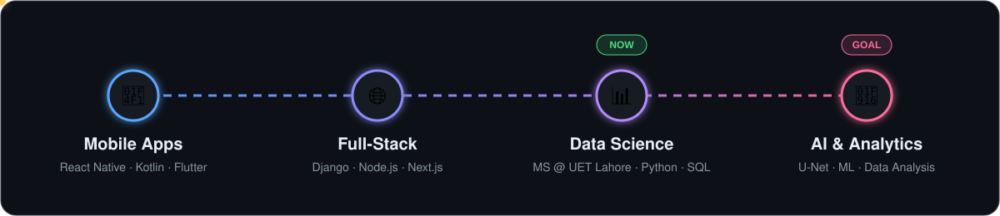

  

  

  
  
  

  <a href="#-about-me">About</a> &nbsp;•&nbsp;
  <a href="#-my-journey">Journey</a> &nbsp;•&nbsp;
  <a href="#-tech-stack">Tech Stack</a> &nbsp;•&nbsp;
  <a href="#-featured-projects">Projects</a> &nbsp;•&nbsp;
  <a href="#-experience--education">Experience</a> &nbsp;•&nbsp;
  <a href="#-github-snapshot">Stats</a> &nbsp;•&nbsp;
  <a href="#-lets-connect">Connect</a>

## 🧑‍🚀 About Me

- 🤖 Moving from mobile and full-stack development into **AI and data analysis**
- 🎓 Pursuing an **MS in Data Science** at UET Lahore (BSc Information Engineering Technology, CGPA 3.45)
- 🌫️ Built an **AI image dehazing system** (custom U-Net) trained on 65,000+ hazy/clear image pairs
- 🕌 Exploring **audio classification** with machine learning on Quran recitations
- 🛠️ Three years of shipping apps with **React Native, Kotlin, Flutter, Django and Node.js**
- 🧪 Careful about quality: API testing, debugging, and functional testing are part of my workflow

> *"Good products come from clean engineering and real empathy for the user."*

## 🧭 My Journey

  

## 🧰 Tech Stack

<table>
  <tr>
    <td><b>AI &amp; Data</b></td>
    <td>
      
      
      
      
      
    </td>
  </tr>
  <tr>
    <td><b>Databases</b></td>
    <td>
      
      
      
      
      
      
    </td>
  </tr>
  <tr>
    <td><b>Web</b></td>
    <td>
      
      
      
      
    </td>
  </tr>
  <tr>
    <td><b>Mobile</b></td>
    <td>
      
      
      
      
      
    </td>
  </tr>
  <tr>
    <td><b>Tools &amp; QA</b></td>
    <td>
      
      
      
      
      
    </td>
  </tr>
</table>

## 🚀 Featured Projects

  <table>
    <tr>
      <td width="50%" valign="top">
        <h3>🌫️ AI-Powered Image Dehazing</h3>
        
Python · U-Net · Computer Vision

        
Custom U-Net trained on 65,000+ hazy/clear image pairs from Kaggle. Removes fog and smog from images and video in real time (reported 99.9% SSIM / 52 dB PSNR).

        
      </td>
      <td width="50%" valign="top">
        <h3>🕌 Quran Recitation Audio Classification</h3>
        
Python · Machine Learning · Audio

        
Classifies different recitations using audio preprocessing, feature extraction, and classification models.

        
      </td>
    </tr>
    <tr>
      <td width="50%" valign="top">
        <h3>🕸️ Web Scraper App</h3>
        
Python · Data Collection

        
Keyword analysis of any public webpage with live highlighting, CSV/TXT export, and clear errors for invalid URLs and network failures.

        
      </td>
      <td width="50%" valign="top">
        <h3>🛠️ AuraUserve Mobile App</h3>
        
React Native · Node.js · Firebase

        
Home-services booking platform with real-time bookings, authentication, notifications, and a web companion (Home-Service-Connect).

        
      </td>
    </tr>
    <tr>
      <td width="50%" valign="top">
        <h3>📍 Family Locator System</h3>
        
Jetpack Compose · JWT

        
Group-based live location sharing with emergency alerts, background tracking, and battery-conscious syncing.

        
      </td>
      <td width="50%" valign="top">
        <h3>📺 Screen Mirroring App</h3>
        
Kotlin · Published on Google Play

        
Screen sharing, browser mirroring, game streaming, screenshots, and recording with secure permission handling.

        
      </td>
    </tr>
  </table>

  Also on my profile: <a href="https://github.com/usmana5809/Smart-Learning-Management-System">Smart LMS</a> ·
  <a href="https://github.com/usmana5809/ShopVista-E-commerce">ShopVista</a> ·
  <a href="https://github.com/usmana5809/Home-Service-Connect-Web-App">Home-Service-Connect</a> ·
  <a href="https://github.com/usmana5809/Oracle-Database-Project">Oracle Database Project</a> ·
  <a href="https://usmana-portfolio.netlify.app/"><b>See all 16 projects in my portfolio →</b></a>

## 🔎 Experience & Education

| When | What |
| :-- | :-- |
| **Sep 2024 – Sep 2026** | **Mobile & Full-Stack Developer, CodeSynergy Lab.** Built cross-platform and Android apps (React Native, Flutter, Kotlin) and contributed to the e-Hikmat healthcare app (Flutter, Django REST APIs). Explored AI integration and automation. |
| **Jun 2024 – Aug 2024** | **Web Development Intern, CodeSquad.AI (Remote).** Built Python web scraping with AI-assisted data processing and CSV/TXT export, plus responsive React.js and Next.js apps. |
| **Sep 2023 – Jun 2024** | **University Capstone, Full-Stack Lead.** Led AuraUserve (React Native, Node.js, Firebase, MongoDB) and Home-Service-Connect. |
| **2026 – Present** | 🎓 **MS Data Science**, University of Engineering & Technology (UET), Lahore |
| **BSc** | 🎓 **Information Engineering Technology**, Superior University, Lahore (CGPA 3.45) |
| **2022** | 📜 **AI/ML Certificate**, NAVTTC |

## 📊 GitHub Snapshot

  
  

  

  

  <picture>
    <source media="(prefers-color-scheme: dark)" srcset="https://raw.githubusercontent.com/usmana0820/usmana0820/output/github-contribution-grid-snake-dark.svg" />
    <source media="(prefers-color-scheme: light)" srcset="https://raw.githubusercontent.com/usmana0820/usmana0820/output/github-contribution-grid-snake.svg" />
    
  </picture>

## 🤝 Let's Connect

  
  
  
  
  

  🚀 Open to AI and data roles, and to collaborations on meaningful AI, mobile, and full-stack products. 
  ⭐ If you like my work, star a repo or send me a message!

